# PulseID — Application Architecture Specification

## 1. System Vision & Architecture Principles

PulseID is engineered as a **modular monolith** on Next.js 16.4.3 (App Router) and React 19.3.0. It bridges healthcare consumers (Patients), clinical care providers (Doctors), and pharmaceutical professionals (Pharmacists) on top of a centralized, strongly-typed backend integration layer connected to the Clincs Plus API v1.

```mermaid
flowchart TD
    subgraph Client["Presentation Layer (Next.js 16.4.3 App Router)"]
        Public["Public Landing Page (/)"]
        Auth["Authentication Module (/auth/*)"]
        PatientPortal["Patient Portal (/patient/*)"]
        DoctorPortal["Doctor Portal (/doctor/* - Planned M4)"]
        PharmacyPortal["Pharmacist Portal (/pharmacist/* - Planned M5)"]
    end

    subgraph Core["Shared Application Infrastructure"]
        AuthProvider["Centralized AuthProvider (src/lib/auth/auth-context.tsx)"]
        TokenStorage["TokenStorage (Opaque Token Management & Demo Purging)"]
        ApiClient["Centralized Typed API Client (src/lib/api/client.ts)"]
        ServiceLayer["Domain Services (Auth, Patient, Medical, Reference)"]
    end

    subgraph Backend["PulseID Cloud Run Backend API (v1)"]
        PatientApi["/api/v1/Patient/*"]
        UsersApi["/api/v1/Users/*"]
        DoctorApi["/api/v1/Doctor/* (Multipart)"]
        ClinicalApi["Clinical Entities (Allergies, Meds, Chronic, History, Surgeries)"]
        GeoApi["Geographic Entities (States, Cities)"]
    end

    Public --> Auth
    Auth --> AuthProvider
    PatientPortal --> AuthProvider
    DoctorPortal -.-> AuthProvider
    PharmacyPortal -.-> AuthProvider

    AuthProvider --> TokenStorage
    AuthProvider --> ServiceLayer
    PatientPortal --> ServiceLayer

    ServiceLayer --> ApiClient
    ApiClient --> TokenStorage
    ApiClient -->|JWT/Bearer + Lang Headers| Backend
```



---

## 2. Directory Layout & Feature Module Organization

```
PulseID/
├── docs/                                  # Architectural & regulatory documentation
│   ├── API_INTEGRATION.md                 # 73-endpoint inventory & DTO specifications
│   ├── APP_ARCHITECTURE.md                # System design & data flow specification
│   ├── INTEGRATION_STATUS.md              # Feature-by-feature implementation matrix
│   ├── TESTING.md                         # Quality assurance & Playwright strategy
│   └── DESIGN_SYSTEM.md                   # Brand guidelines & Tailwind tokens
├── public/
│   ├── assets/
│   │   ├── auth/                          # Authentic Figma auth assets & illustrations
│   │   └── patient-home/                  # 37 authentic Figma patient landing assets
│   └── landing/                           # Marketing illustrations
├── src/
│   ├── app/                               # Next.js App Router route hierarchy
│   │   ├── (auth)/
│   │   │   └── auth/
│   │   │       ├── role/page.tsx          # Role Selection (Figma 238:665)
│   │   │       ├── register/page.tsx      # Phone registration (Figma 116:903)
│   │   │       ├── verify/page.tsx        # OTP Verification screen (Figma 116:1127)
│   │   │       ├── info/page.tsx          # Personal info registration (Figma 116:1028)
│   │   │       └── login/page.tsx         # User login screen (Figma 116:956)
│   │   ├── patient/                       # Patient Portal
│   │   │   ├── page.tsx                   # Patient Home Dashboard (Figma 299:4931)
│   │   │   ├── profile/page.tsx           # Digital Medical ID & Profile
│   │   │   ├── profile/edit/page.tsx      # Health Info Edit Form
│   │   │   ├── medical-info/page.tsx      # Clinical Conditions & Allergies
│   │   │   ├── records/page.tsx           # Medical Records Explorer (Prototype)
│   │   │   └── access-requests/page.tsx   # Consent Ledger (Prototype)
│   │   ├── layout.tsx                     # Root Layout (Mounts AuthProvider)
│   │   └── page.tsx                       # Public Landing Page
│   ├── components/ui/                     # Atomic UI primitives
│   ├── features/                          # Feature modules
│   │   ├── auth/components/               # RoleSelector, Register, OTP, Login forms
│   │   ├── landing/components/            # Hero, Challenges, Solutions, Complete sections
│   │   └── patient/components/            # Dashboard widgets, Banners, Navbars
│   └── lib/
│       ├── api/                           # Centralized API Integration Layer
│       │   ├── client.ts                  # ApiClient singleton, TokenStorage, ApiError
│       │   ├── types.ts                   # Pure OpenAPI DTOs & UI Presentation models
│       │   ├── auth-service.ts            # AuthService (Real login/registration)
│       │   ├── patient-service.ts         # PatientService (Profile CRUD)
│       │   ├── medical-service.ts         # MedicalService (Allergies, Meds, Chronic CRUD)
│       │   ├── reference-service.ts       # ReferenceService (BloodTypes, States, Cities)
│       │   └── index.ts                   # Module barrel export
│       └── auth/
│           └── auth-context.tsx           # Centralized AuthProvider and useAuth() hook
```

---

## 3. Core Architectural Subsystems

### 3.1 Centralized API Client (`src/lib/api/client.ts`)
- **Environment Safety:** Requires an explicit `NEXT_PUBLIC_API_BASE_URL`. Fails fast with a configuration error if missing to prevent accidental submission to an unintended backend.
- **Request Lifecycle:**
  1. Base URL resolution from `NEXT_PUBLIC_API_BASE_URL`.
  2. Automatic `lang: en` header injection.
  3. Automatic `Authorization: Bearer <token>` injection for opaque tokens in `TokenStorage`.
  4. Automatic `Content-Type: application/json` for JSON payloads.
  5. Content-Type suppression for `FormData` / multipart requests.
  6. 15-second request cancellation timeout via `AbortController`.
  7. Safe parsing of empty responses (HTTP 204 or empty string).
  8. Safe parsing of non-JSON error payloads (HTML 502/503 from Cloud Run).
  9. Typed error mapping into `ApiError` instances (`VALIDATION_ERROR`, `BUSINESS_ERROR`, `UNAUTHENTICATED`, `FORBIDDEN`, `NOT_FOUND`, `SERVER_ERROR`, `NETWORK_ERROR`, `TIMEOUT_ERROR`).
  10. Strict rule: never fall back to mock data when an API request fails.

### 3.2 Authentication & State Management (`src/lib/auth/auth-context.tsx`)
- **Provider Pattern:** `AuthProvider` wraps the entire component tree in `src/app/layout.tsx`.
- **Opaque Token Handling:** The client treats all tokens as opaque strings. No assumptions are made about token formatting (JWT, UUID, hex). Tokens are never decoded client-side.
- **Conservative Session Initialization:**
  - On mount, inspects `localStorage` for `pulseid_auth_token`.
  - Rejects and purges legacy simulation tokens (`pulseid_jwt_demo_`, `pulseid_jwt_offline_`, `pulseid_token_local_`, `mock_jwt_token_`).
  - **Stored Token Presence != Session Validity:** When an opaque token is restored from storage, `isAuthenticated: true` is established on the client, but `isTokenVerified: false` remains unverified until confirmed by an active backend response.
  - `/api/Patient/AuthenticatUser` is explicitly bypassed because it returns true unconditionally.
- **Role Determination:** Role is extracted strictly from the backend response (`typeId: 1` -> patient, `2` -> doctor, `3` -> pharmacist). If the backend omits role information, `userRole` remains `null` (unconfirmed role). Portal routing defaults to safe patient paths and does **not** grant doctor or pharmacist access based on user input.

### 3.3 Registration Endpoints & Protocol Correctness
- **Patient Registration:** Dispatched to `POST /api/v1/Patient/Create` with `UserAddUpdateDTO` (`typeId: 1`). `bloodTypeId` is left `undefined` to prevent foreign key violations against the unseeded backend table.
- **Doctor & Pharmacist Registration:** Require `POST /api/v1/Doctor/Create` with `multipart/form-data` and `UserAddUpdateDoctorDTO` (license files, state/city foreign keys). Routing professional registration to generic `/Users/Create` has been eliminated and documented as scheduled for Milestones 4 and 5.

### 3.4 Blood Type Reference Data & Presentation Boundaries
- **Backend Service:** `ReferenceService.getBloodTypes()` returns the live database records. If the remote database has 0 seeded records, it returns `[]`.
- **Presentation Fallback:** `ReferenceService.PRESENTATION_ONLY_BLOOD_TYPES` is strictly isolated for offline UI mockup display.
- **Foreign Key Guard:** Fallback IDs (1-8) are **never** submitted as foreign keys to backend endpoints. The profile editor displays an explicit unavailable-data state (`"Blood types unavailable from server (Reference data unseeded)"`) when the table is empty.

### 3.5 Security Architecture & Interim Limitations
- **Current Approach:** Bearer token stored in `localStorage`. Documented as an **interim limitation** subject to XSS risk.
- **HttpOnly Cookie Feasibility:** The Clincs Plus API v1 backend does not natively support cookie-based sessions or emit `Set-Cookie` headers. Transitioning to HttpOnly cookies would require backend changes or a Next.js BFF proxy layer routing requests through Next.js Route Handlers. No fake client-only cookie mechanism is introduced.
