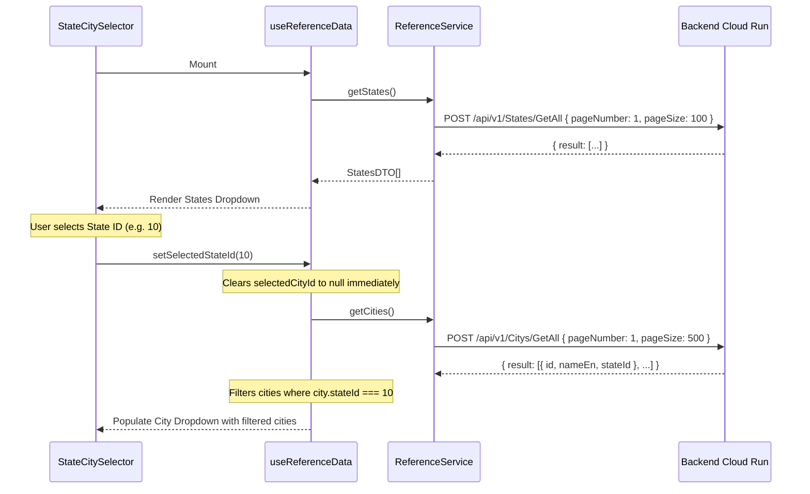

# PulseID — System Architecture Specification

## 1. Architectural Philosophy

PulseID is engineered around a **modular, API-driven, feature-oriented healthcare frontend architecture** built on Next.js App Router, React 19, TypeScript strict mode, and Tailwind CSS v4.

Key architectural pillars:
- **Server Components by default:** Landing sections, layouts, static documents, and SEO metadata render server-side with zero client JavaScript payload.
- **Strict Client Leaf Isolation:** Interactive state (`'use client'`) is isolated to interactive leaves: form controls, countdown timers, mobile drawers, and auth session providers.
- **Single Source of Truth:** All API communication is channeled through a centralized singleton `ApiClient` (`src/lib/api/client.ts`). Components never perform ad-hoc `fetch()` calls.
- **Role Isolation & Usability Boundaries:** Role-specific portals (`/patient`, `/doctor`, `/pharmacist`) are protected by `<RoleGuard>`. Roles are strictly derived from backend authentication responses (`typeId: 1` = Patient, `2` = Doctor, `3` = Pharmacist).
- **API-Driven Dynamic Reference Data:** Dropdown options (States, Cities, Blood Types) are fetched directly from live backend endpoints. No hardcoded geographic arrays or dummy options exist in UI components.
- **Zero Fake Data:** Empty backend tables render honest empty states. Synthetic IDs and fallback mockup records are never submitted as foreign keys.
- **Separation of Concerns:** Distinct separation between server state, authentication state, form state, and local UI state.

---

## 2. Directory Structure & Modular Organization

```
src/
├── app/
│   ├── (auth)/                           # Route group for authentication
│   │   └── auth/
│   │       ├── layout.tsx                # Centered auth card layout
│   │       ├── role/page.tsx             # Role selection (Patient, Doctor, Pharmacist)
│   │       ├── login/page.tsx            # Unified login screen (Users/Login)
│   │       ├── register/page.tsx         # Phone entry
│   │       ├── register/info/page.tsx    # Role-specific personal information
│   │       └── verify/page.tsx           # OTP verification (SMS gateway prototype)
│   ├── doctor/                           # Doctor Clinical Workspace (RoleGuard: doctor)
│   │   ├── layout.tsx                    # Role-protected doctor layout
│   │   └── page.tsx                      # Clinical diagnostic & prescription workspace
│   ├── pharmacist/                       # Pharmacist Dispensary Hub (RoleGuard: pharmacist)
│   │   ├── layout.tsx                    # Role-protected pharmacist layout
│   │   └── page.tsx                      # E-prescription scanner & dispensation queue
│   ├── patient/                          # Patient Identity Portal (RoleGuard: patient)
│   │   ├── layout.tsx                    # Role-protected patient layout
│   │   ├── page.tsx                      # Patient dashboard
│   │   ├── access-requests/page.tsx      # Provider consent management
│   │   ├── medical-info/page.tsx         # Real CRUD (Allergies, Chronic, Meds)
│   │   ├── profile/page.tsx              # Digital ID card & emergency contacts
│   │   ├── profile/edit/page.tsx         # Profile edit form & blood type selector
│   │   └── records/page.tsx              # Medical records explorer
│   ├── layout.tsx                        # Root layout wrapping AuthProvider
│   └── page.tsx                          # Public launch landing page
├── components/
│   ├── auth/
│   │   └── role-guard.tsx                # Universal role-based route guard
│   └── ui/                               # Atomic primitives (Button, Card, Select, Logo)
├── features/
│   ├── auth/                             # Authentication domain module
│   │   ├── components/
│   │   │   ├── AuthCardShell.tsx         # Responsive two-column auth container
│   │   │   ├── LoginForm.tsx             # Unified login form (all roles)
│   │   │   ├── RoleSelector.tsx          # Account type selector
│   │   │   ├── RegisterEntryForm.tsx     # Phone capture
│   │   │   ├── PersonalInfoForm.tsx      # Registration container (role dispatcher)
│   │   │   ├── PatientRegisterForm.tsx   # Dedicated patient registration
│   │   │   ├── DoctorRegisterForm.tsx    # Dedicated doctor multipart registration
│   │   │   ├── PharmacistRegisterForm.tsx# Dedicated pharmacist multipart registration
│   │   │   └── StateCitySelector.tsx     # Dynamic API state/city selector
│   │   └── index.ts                      # Barrel export
│   ├── landing/                          # Public landing page sections & components
│   └── patient/                          # Patient portal UI sections & components
├── lib/
│   ├── api/                              # Centralized API service layer
│   │   ├── client.ts                     # Singleton ApiClient & TokenStorage
│   │   ├── types.ts                      # OpenAPI DTOs & domain contracts
│   │   ├── auth-service.ts               # Users/Login & role dispatchers
│   │   ├── patient-service.ts            # Patient CRUD & profile management
│   │   ├── doctor-service.ts             # Doctor multipart registration & directory
│   │   ├── pharmacist-service.ts         # Pharmacist multipart registration & directory
│   │   ├── medical-service.ts            # Clinical CRUD (Allergies, Medications)
│   │   ├── reference-service.ts          # States, Cities, Blood types API caller
│   │   └── use-reference-data.ts         # React hook for dynamic reference data
│   ├── auth/
│   │   └── auth-context.tsx              # 5-state auth lifecycle provider & useAuth hook
│   ├── constants.ts                      # Immutable brand & application constants
│   └── utils.ts                          # Shared utility helpers (cn)
└── types/
    └── index.ts                          # Shared core type definitions
```

---

## 3. Centralized Authentication Architecture

All user roles authenticate through a single endpoint:

```
POST /api/v1/Users/Login
Headers: lang: en
Body: { userName, password }
```

### 3.1 5-State Authentication Lifecycle

The `AuthProvider` (`src/lib/auth/auth-context.tsx`) manages session state across 5 distinct phases:

1. **`initializing`**: Client mount; inspecting `localStorage` for stored tokens. Renders accessible loading state.
2. **`unauthenticated`**: No stored credentials or explicit user logout.
3. **`authenticated-unverified`**: Stored token loaded from browser storage. Token presence is **never** treated as verified session proof until a live API call succeeds.
4. **`authenticated-verified`**: Backend confirmed valid session. Stored in state with confirmed role.
5. **`auth-error`**: Login failure or credentials rejected by backend.

### 3.2 Role Mapping & Redirection

The authenticated role is determined exclusively by the backend response:
- `typeId: 1` ➔ Patient (`/patient`)
- `typeId: 2` ➔ Doctor (`/doctor`)
- `typeId: 3` ➔ Pharmacist (`/pharmacist`)

---

## 4. Role-Specific Registration Suite

Registration endpoints are separate and role-specific:

| Role | Endpoint | Content-Type | DTO Contract | Required Attributes |
|---|---|---|---|---|
| **Patient** | `POST /api/v1/Patient/Create` | `application/json` | `UserAddUpdateDTO` | `Id` (UUID), `NameEn`, `NameAr`, `BirthDate`, `GenderTypeId`, `TypeId: 1`, `Email`, `Phone`, `NationalId`, `UserName`, `Password`, clinical arrays `[]`. |
| **Doctor** | `POST /api/v1/Doctor/Create` | `multipart/form-data` | `UserAddUpdateDoctorDTO` | `Id`, `NameEn`, `NameAr`, `GenderTypeId`, `TypeId: 2`, `Email`, `Phone`, `NationalId`, `License`, `StateId`, `CityId`, optional license files. |
| **Pharmacist** | `POST /api/v1/Doctor/Create` | `multipart/form-data` | `UserAddUpdateDoctorDTO` | `Id`, `NameEn`, `NameAr`, `GenderTypeId`, `TypeId: 3`, `Email`, `Phone`, `NationalId`, `License`, `StateId`, `CityId`, optional license files. |

---

## 5. Dynamic Reference Data & Dependent State/City Architecture



### Critical EF Core Serialization Safety Rule
When requesting backend pagination endpoints (`States/GetAll`, `Citys/GetAll`, `AllergyMenu/GetAll`, etc.):
- **Never send empty arrays or empty objects** (`orderByValue: []`, `filter: {}`). The ASP.NET Core EF Core backend crashes with HTTP 500 when empty arrays are deserialized for these parameters.
- Sending clean `{ pageNumber: 1, pageSize: 100 }` (or `{ pageNumber, pageSize, filter: { patientId } }`) succeeds with HTTP 200.
