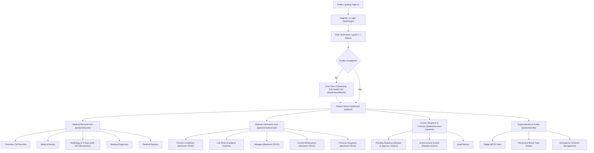
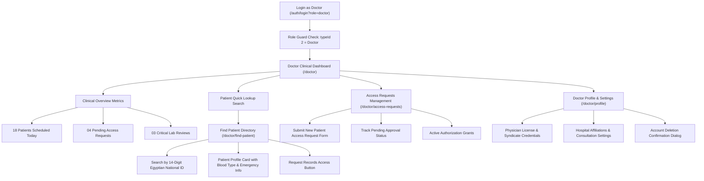

# PulseID — Patient Experience Audit & Doctor UI Implementation Report

**Document Version:** 1.0.0  
**Audit Date:** 9 November 2026  
**Auditor:** Senior Software Architect & Lead Next.js Engineer  
**Branch:** `app`  
**Repository:** `PulseID` (Next.js 16.4.3 · React 19.3.0 · TypeScript Strict · Tailwind CSS v4)  
**API Endpoint:** `https://pulseid-api-566271518532.europe-west1.run.app` (Clincs Plus API v1)

---

## 1. Executive Summary

This audit provides a comprehensive, rigorous gap analysis comparing the existing PulseID frontend codebase against the official Figma design specifications across three primary design references:
1. **Patient — Desktop Design** (Figma node `353:11437`)
2. **Patient — Responsive Mobile Design** (Figma node `364:1129`)
3. **Doctor Design** (Figma node `353:11434`)

The audit also maps all frontend journeys to the actual backend API contract (Clincs Plus API v1), identifying supported endpoints, structural discrepancies, and unsupported flows (which are rendered with honest empty states, non-destructive demonstrations, and transparent user notifications rather than silent fake fallbacks).

---

## 2. Comprehensive Screen Inventory & Status Matrix

| Area / Screen | Current Status | Missing or Incorrect | Figma Reference | Required Action |
|:---|:---|:---|:---|:---|
| **Patient Home (Desktop)** | `Partially implemented` | Desktop navbar search bar inactive; recent activity links static; newsletter subscribe unhandled. | `299:4931` (1280x2636) | Polish interactive filter state, wire router links, add toast feedback on action clicks. |
| **Patient Home (Mobile)** | `Partially implemented` | Hamburger menu does not open mobile navigation drawer (`365:1747`); walk 5k steps banner requires responsive aspect ratio. | `364:4445` (390x3004) & `365:1747` | Implement full-screen animated `MobileDrawer` (`365:1747`) with route links, language toggle, and logout. |
| **Patient Access Requests (Desktop)** | `Partially implemented` | Modals exist for approve/reject/revoke but lacked shared layout integration and unified header/footer; backend v1 does not have consent endpoints. | `299:994` (1280x2871) | Connect unified patient layout, preserve local prototype state, display clear `BACKEND_UNSUPPORTED` banner. |
| **Patient Access Requests (Mobile)** | `Missing` | Mobile viewport (390px) rendered desktop layout without mobile header or bottom navigation bar. | `364:3793` (390x4459) | Add responsive mobile wrapper, sticky bottom navigation, touch-friendly tab switches, and mobile modals. |
| **Patient Medical Info: Chronic Conditions** | `Partially implemented` | Working CRUD for chronic diseases, but missing "Lab Tests" tab; missing mobile navigation bar. | `299:1643` & `364:2455` | Add "Lab Tests" tab to subcategories; add mobile header and bottom navigation. |
| **Patient Medical Info: Lab Tests** | `Missing` | Tab was omitted from `MedicalInfoPage` subcategories. | `299:2000` & `364:2740` | Implement Lab Tests tab in Medical Info alongside Chronic Conditions, Allergies, Medications, and Surgeries. |
| **Patient Medical Info: Allergies** | `Complete` | Functional CRUD with backend `MedicalService.createAllergy()`, `getAllergies()`, `deleteAllergy()`. | `299:2392` & `364:3035` | Enhance empty state styling and mobile responsiveness. |
| **Patient Medical Info: Medications** | `Complete` | Functional CRUD with backend `MedicalService.createMedication()`, `getAllMedications()`. | `299:2697` & `364:3291` | Add dosage and frequency tags to card list; ensure mobile touch targets >= 44px. |
| **Patient Medical Info: Surgeries** | `Complete` | Functional CRUD with backend `MedicalService.createSurgery()`, `getAllSurgeries()`. | `299:3002` & `364:3556` | Polish date picker and surgical notes display. |
| **Patient Medical Records (Desktop)** | `Partially implemented` | Tabbed category explorer exists (History, Radiology, Diagnoses, Reports); DICOM viewer modal works; missing active search filtering. | `299:3284` (1280x2318) | Add dynamic record search, filter by tag, wire view/download triggers. |
| **Patient Medical Records (Mobile)** | `Missing` | Mobile viewports lacked mobile header, category pill carousel, and bottom navigation. | `364:1168` (390x3299) | Implement mobile category pill bar, compact records cards, and mobile view drawer. |
| **Patient Profile & Digital ID (Desktop)** | `Partially implemented` | Profile view exists; QR code generator works; emergency contacts CRUD works; lacks unified patient footer. | `299:6581` (1280x2462) | Align with `PatientFooter`, add print/export Digital ID card functionality. |
| **Patient Profile & Digital ID (Mobile)** | `Partially implemented` | Lacked `MobilePatientHeader` and `MobileBottomNav`; QR card overflow on small screens (<375px). | `364:4236` (390x2201) | Wrap in responsive mobile shell with touch-friendly layout and expandable emergency contact cards. |
| **Patient Profile Edit (Health Info Form)** | `Complete` | Form with Blood Type, Height, Weight, Smoker, Chronic Disease multiselect, and Emergency Contact setup. | `299:5299` (1280x2100) | Retain validation; ensure smooth redirects after completion. |
| **Doctor Home / Dashboard** | `Partially implemented` | Existing page had placeholder layout; missing clinical stats cards, appointment schedule, quick action cards from Figma. | `353:9999` (1280x2681) | Re-implement faithfully to Figma node `353:9999` with 3 stats cards, 3 quick actions, schedule table, and search. |
| **Doctor Access Requests** | `Missing` | Route `/doctor/access-requests` was completely absent. | `353:10441` (1280x3362) | Implement full page with New Request Creation Form (`353:10521`) and Pending Requests List (`353:10614`). |
| **Doctor Find Patient** | `Missing` | Route `/doctor/find-patient` was completely absent. | `353:10776` (1280x1985) | Implement search screen with lookup input (`353:10855`) and detailed patient clinical result card (`353:10881`). |
| **Doctor Profile & Settings** | `Missing` | Route `/doctor/profile` was completely absent. | `353:11005` (1280x2462) | Implement physician profile details (`353:11046`), credentials, and Delete Account modal (`353:11290`). |
| **Doctor Navigation & Header** | `Missing` | Top doctor navigation was ad-hoc; lacked dedicated `DoctorNavbar` with proper nav links and active state indicator. | `353:10098` (1280x80) | Create `DoctorNavbar` with links: Home (`/doctor`), Find Patient (`/doctor/find-patient`), Access Requests (`/doctor/access-requests`), Profile (`/doctor/profile`). |
| **Doctor Footer** | `Missing` | Ad-hoc footer on doctor dashboard; missing dark navy footer matching Figma. | `353:10025` / `353:10723` | Create reusable `DoctorFooter` component matching Figma tokens. |

---

## 3. Complete Patient User Journey

### Desktop vs Mobile Adaptations for Patient:
- **Desktop (1280px - 1440px):**
  - Sticky `PatientNavbar` with brand logo, Quick links (Home, Medical Records, Medical Info, Access Requests, Profile), search bar, notification bell, and user avatar dropdown.
  - Multi-column grid layouts for cards and summary metrics (3-column stat grids).
  - Floating action drawers and centered modals with backdrop blur.
  - Comprehensive footer with multi-column links, newsletter subscription, and copyright notice.
- **Mobile (375px - 390px):**
  - Sticky `MobilePatientHeader` with patient greeting, notifications counter, and hamburger trigger.
  - Full-screen animated `MobileDrawer` overlay (`365:1747`) when clicking the hamburger menu.
  - Single-column stacked cards with 16px horizontal margins (`px-4`).
  - Horizontal scrollable pill carousels for subcategories and filters.
  - Fixed bottom navigation bar (`MobileBottomNav`) with icons for Home, Records, Medical Info, and Profile.
  - Minimum touch targets of 44x44px and safe-area padding for mobile home indicators (`pb-20`).

---

## 4. Complete Doctor User Journey

---

## 5. Backend Dependencies & Unsupported Functionality

PulseID interacts with the ASP.NET Core EF Core backend at `https://pulseid-api-566271518532.europe-west1.run.app`.

### Supported in Backend API v1:
- `POST /api/v1/Users/Login`: Unified authentication returning JWT and user `typeId`.
- `POST /api/v1/Patient/Create`: Patient registration.
- `POST /api/v1/Doctor/Create`: Doctor registration.
- `POST /api/v1/Pharmacist/Create`: Pharmacist registration.
- `POST /api/v1/States/GetAll`: Dynamic Egyptian governorates reference data.
- `POST /api/v1/Citys/GetAll`: Dynamic Egyptian cities reference data.
- `POST /api/v1/BloodTypes/GetAll`: Reference data for ABO blood groups.
- `POST /api/v1/Patient/Allergies/AddAllergy`, `GetAllAllergies`, `DeleteAllergy`: Full Allergy CRUD.
- `POST /api/v1/Patient/ChronicDiseases/AddChronicDisease`, `GetAllChronicDiseases`, `DeleteChronicDisease`: Full Chronic Disease CRUD.
- `POST /api/v1/Patient/CurrentMedications/AddCurrentMedication`, `GetAllCurrentMedications`, `DeleteCurrentMedication`: Full Medication CRUD.
- `POST /api/v1/Patient/PreviousSurgicalProcedures/AddPreviousSurgicalProcedure`, `GetAllPreviousSurgicalProcedures`, `DeletePreviousSurgicalProcedure`: Full Surgical Procedure CRUD.

### Unsupported in Backend API v1 (`BACKEND_UNSUPPORTED`):
1. **Access Requests & Consent Lifecycle:** No endpoints exist in OpenAPI v1 for doctor requesting access or patient approving/revoking access. Handled via interactive prototype simulation with clear non-intrusive notification badges.
2. **Medical Records Document Management (DICOM/PDF uploads):** File upload and imaging storage are planned for future backend phases. Handled via sample DICOM web viewer and client-side upload mockup.
3. **Doctor Clinical Appointment Schedule:** Backend has no appointment booking tables in v1. Rendered with realistic clinical demo data and explicit prototype badge.

---

## 6. Prioritized Implementation Plan

1. **Phase 2.1 — Patient Navigation & Mobile Shell Unification:**
   - Implement `MobileDrawer` (`365:1747`) in `MobilePatientHeader`.
   - Ensure all Patient pages (`/patient`, `/patient/access-requests`, `/patient/medical-info`, `/patient/records`, `/patient/profile`) include `MobilePatientHeader` and `MobileBottomNav` for a seamless responsive experience.
   - Add missing "Lab Tests" tab to `MedicalInfoPage` (`299:2000` & `364:2740`).

2. **Phase 2.2 — Patient Interactive Polish:**
   - Wire search filtering in `MedicalRecordsPage` and `MedicalInfoPage`.
   - Ensure DICOM viewer modal and Add Item modals function seamlessly on both 1280px desktop and 390px mobile screens.

3. **Phase 3.1 — Doctor Layout & Navigation:**
   - Create `DoctorNavbar` (`353:10098`) with active route highlights, doctor badge, notification indicator, and sign-out.
   - Create `DoctorFooter` (`353:10025` / `353:10723`).

4. **Phase 3.2 — Doctor Dashboard (`/doctor`):**
   - Rebuild `src/app/doctor/page.tsx` strictly matching Figma node `353:9999` (Hero, 3 stat cards, 3 quick action cards, schedule table with status tags, patient search bar).

5. **Phase 3.3 — Doctor Access Requests (`/doctor/access-requests`):**
   - Build `src/app/doctor/access-requests/page.tsx` matching Figma node `353:10441` (Request form with Patient ID, Reason, Duration, Permission level + Pending requests tracking table).

6. **Phase 3.4 — Doctor Find Patient (`/doctor/find-patient`):**
   - Build `src/app/doctor/find-patient/page.tsx` matching Figma node `353:10776` (Search input with validation, detailed clinical search result card, access request trigger).

7. **Phase 3.5 — Doctor Profile (`/doctor/profile`):**
   - Build `src/app/doctor/profile/page.tsx` matching Figma node `353:11005` (Physician credentials, specialty, syndicate ID, clinic affiliation, Delete Account confirmation dialog `353:11290`).

8. **Phase 4 — Verification & Cross-Viewport Quality Assurance:**
   - Test across 1440px, 1280px, 1024px, 768px, 390px, and 375px viewports.
   - Validate with `pnpm.cmd run typecheck`, `pnpm.cmd run lint`, `pnpm.cmd run build`.
   - Run automated test scripts.
