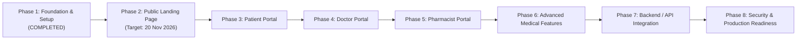

# PulseID — Strategic Engineering Roadmap

## 1. Roadmap Overview & Phasing

The development of PulseID is organized into eight strategic phases designed to move smoothly from initial foundation through public marketing launch to full medical enterprise readiness.

---

## 2. Confirmed Requirements (The 8 Project Phases)

### Phase 1 — Foundation & Project Setup *(Status: Completed)*
- Initialize Next.js 16 with App Router, Turbopack, and TypeScript strict mode.
- Integrate Tailwind CSS v4 and ESLint.
- Configure pnpm package manager with approved build dependencies.
- Establish feature-oriented architecture.
- Compile initial verification builds and author technical documentation.

### Phase 2 — Public PulseID Launch Landing Page *(Status: Immediate Priority)*
- Deliverable: A high-performance, single-page marketing website.
- Target Launch Date: **20 November 2026**.
- Content: Vision overview, role highlights (Patient, Doctor, Pharmacist), countdown timer, early access / waitlist signup, accessibility compliance (WCAG 2.1 AA).
- Server-rendered by default, optimized for SEO, Core Web Vitals, and mobile responsiveness.

### Phase 3 — Patient Application
- Digital Patient Medical ID.
- Personal medical history and vitals viewer.
- Active prescription tracker and dispensing status.
- Secure consultation scheduler.

### Phase 4 — Doctor Application
- Clinical provider dashboard and appointment management.
- Patient history exploration and diagnostic record management.
- Electronic Prescription (e-Rx) authoring interface.
- Clinical notation and encounter documentation.

### Phase 5 — Pharmacist Application
- Prescription intake and digital verification queue.
- Dispensing workflow and barcode/batch logging.
- Pharmacy inventory and fulfilment tracking.
- Direct secure doctor communication channel.

### Phase 6 — Advanced Medical Features
- Optical Character Recognition (OCR) for physical paper prescription digitisation.
- AI-assisted diagnostic transcription and clinical summarization.
- Real-time drug-drug interaction (DDI) and allergy conflict alerting engine.

### Phase 7 — Backend / API Integration
- Connect frontend interfaces to enterprise microservices or backend APIs.
- Authentication & Authorization: Role-Based Access Control (RBAC) with MFA.
- Real-time synchronization (WebSockets / Server-Sent Events).
- FHIR (Fast Healthcare Interoperability Resources) / HL7 data format support.

### Phase 8 — Testing, Security & Production Readiness
- Comprehensive end-to-end testing (Playwright) and unit test coverage.
- Healthcare compliance auditing (HIPAA, GDPR, HITRUST).
- Penetration testing, vulnerability assessments, and CSP enforcement.
- Production multi-region deployment and disaster recovery setup.

---

## 3. Proposed Decisions

1. **Phase 2 Execution Sequence:**
   - Milestone 2.1: Implement design tokens and primitive UI components (`Button`, `Card`, `Badge`, `Input`).
   - Milestone 2.2: Implement landing page sections in `src/features/landing/components/`.
   - Milestone 2.3: Assemble `src/app/page.tsx` with responsive layout and SEO metadata.
   - Milestone 2.4: Validate Lighthouse scores (100% SEO, Performance, Accessibility, Best Practices).
2. **Phase 3-5 Delivery Strategy:**
   - Build portal wireframes and mock data flows prior to backend integration to validate UX with healthcare clinicians.

---

## 4. Open Questions

1. **Post-Landing Page Prioritization:**
   - Should Phase 3 (Patient) and Phase 4 (Doctor) be developed sequentially or concurrently?
2. **Target Release Windows for Later Phases:**
   - What are the target calendar deadlines for Phases 3 through 8 following the 20 November 2026 public launch?
3. **Beta Testing Group:**
   - Will a closed clinical trial or private beta cohort be recruited via the Phase 2 landing page?
