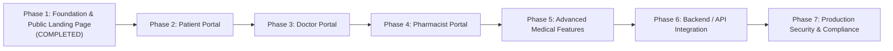

# PulseID — Strategic Engineering Roadmap

## 1. Roadmap Overview & Phasing

---

## 2. Phase Status & Scope

### Phase 1 — Foundation & Public Launch Landing Page *(Status: Completed)*
- **Objective:** Establish the production-grade Next.js App Router foundation and deliver the public marketing landing page ahead of the launch milestone.
- **Target Launch Date:** **20 November 2026** (`Africa/Cairo`, `UTC+2`).
- **Deliverables Completed:**
  - Next.js 16.4.3, React 19.3.0, TypeScript strict mode, Tailwind CSS v4.
  - Premium dark healthcare aesthetic with centralized color tokens.
  - Four primary landing page sections:
    1. Navigation Bar with temporary brand mark and mobile drawer.
    2. Hero section with editorial typography and countdown CTA.
    3. Live launch countdown component with `useSyncExternalStore` and expired state handling.
    4. Meet the Team section with typed role placeholders and initials-based avatars.
    5. Footer with brand description, navigation anchors, and copyright notice.
  - Responsive validation across mobile (375px), tablet (768px), and desktop (1024px+).
  - WCAG 2.1 AA accessibility and full Open Graph / Twitter SEO metadata.

### Phase 2 — Patient Application
- Digital Patient Medical ID (emergency contacts, blood group, allergies, QR code).
- Personal health history, vitals viewer, and appointment tracker.
- Active prescription viewer with dispensing status.

### Phase 3 — Doctor Application
- Clinical provider dashboard and appointment schedule.
- Comprehensive patient chart and diagnostic timeline.
- Electronic Prescription (e-Rx) composer with dosage safety calculations.
- Clinical notation and encounter documentation.

### Phase 4 — Pharmacist Application
- Prescription intake and digital verification queue.
- Dispensing station workflow with batch and expiration logging.
- Pharmacy inventory and fulfillment tracking.
- Secure direct doctor communication channel.

### Phase 5 — Advanced Medical Features
- Optical Character Recognition (OCR) for physical paper prescription digitization.
- AI clinical transcription and diagnostic summarization.
- Real-time drug-drug interaction (DDI) and allergy conflict alerting engine.

### Phase 6 — Backend / API Integration
- Connect frontend interfaces to enterprise microservices or backend APIs.
- Authentication & Authorization: Role-Based Access Control (RBAC) with MFA.
- Real-time synchronization (WebSockets / Server-Sent Events).
- FHIR (Fast Healthcare Interoperability Resources) / HL7 data format support.

### Phase 7 — Testing, Security & Production Readiness
- Comprehensive end-to-end testing (Playwright) and unit test coverage.
- Healthcare compliance auditing (HIPAA, GDPR, HITRUST).
- Penetration testing, vulnerability assessments, and CSP enforcement.
- Production multi-region deployment and disaster recovery setup.

---

## 3. Implemented vs. Remaining Deployment Decisions

| Area | Decision / Status | Notes |
| :--- | :--- | :--- |
| **Landing Page** | Production ready | Can be deployed immediately to Vercel/Netlify/Docker |
| **Official Domain** | Open Question | Pending DNS registration and canonical URL configuration |
| **Brand Assets** | Proposed Temporary SVG | Official vector pack to be swapped upon founder approval |
| **Team Profiles** | Placeholder Roles | Replace `TEAM_MEMBERS` with real portraits and bios prior to launch |
