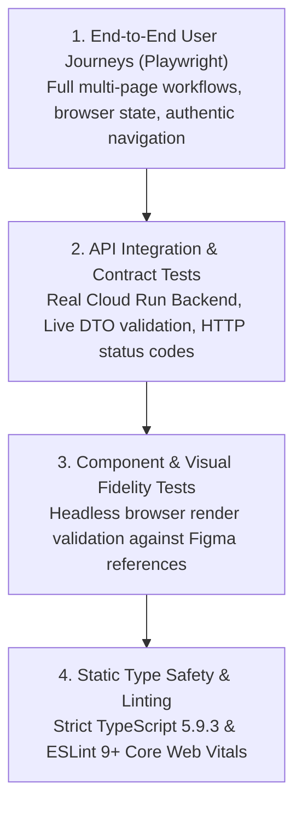

# PulseID — Quality Assurance, Integration & End-to-End Testing Strategy

## 1. Quality Philosophy & Testing Hierarchy

Healthcare applications handle sensitive, mission-critical personal and clinical data. In PulseID, testing is not treated as a post-implementation afterthought. Every capability is verified against static contracts, real backend API responses, and multi-step browser user journeys.



---

## 2. Test Layer Specifications

### 2.1 Static Type Safety & Code Integrity
- **TypeScript:** Strict typecheck executed via `pnpm run typecheck` (`tsc --noEmit`).
  - Zero tolerance for `any` types on API boundaries.
  - Mandatory synchronization between OpenAPI DTO definitions and frontend TypeScript interfaces.
- **ESLint:** Code quality verified via `pnpm run lint` (`eslint-config-next 16.4.3`).
  - Zero warnings, zero errors.
  - Strict React 19 hook purity and hydration mismatch prevention.

### 2.2 Live Backend API Integration Testing
Testing against the real Cloud Run backend (`https://pulseid-api-566271518532.europe-west1.run.app`) verifies contract adherence without mock bias.

#### Required Test Scenarios:
1. **Authentication:**
   - Patient Login with authentic phone/email credentials -> HTTP 200 with Bearer token.
   - Doctor/User Login -> HTTP 200 with role metadata.
   - Invalid password -> HTTP 400/401 with normalized error string.
2. **Clinical Data Read/Write:**
   - `GET /api/v1/BloodType/GetAll` -> Populates blood type dropdowns.
   - `POST /api/v1/Patient/Update` -> Persists updated DOB and emergency contacts.
   - `POST /api/v1/AllergyMenu/GetAll` -> Returns filtered list for authenticated patient ID.
   - `POST /api/v1/CurrentMedications/GetAll` -> Retrieves active prescriptions.
3. **Network Resilience & Edge Cases:**
   - Handling network failure or timeout gracefully with user-facing retry actions.
   - Intercepting HTTP 401 and redirecting to `/auth/login?expired=true`.
   - Handling HTTP 403 Forbidden when accessing another role's records.

---

## 3. End-to-End (E2E) Journey Test Scenarios (Playwright)

```
e2e/
├── auth.spec.ts                           # Registration, Login, Role Routing
├── patient-portal.spec.ts                 # Full Patient Lifecycle & Profile Guard
├── doctor-workflow.spec.ts                # Patient Lookup & e-Rx
├── rbac-guard.spec.ts                     # Cross-role access protection
└── fixtures/
    ├── test-accounts.ts                   # Pre-seeded test credentials
    └── test-patient-data.ts               # Sample clinical records
```

### Scenario Matrix

| ID | Scenario | Given | When | Then | Classification |
|---|---|---|---|---|---|
| `TC-AUTH-01` | Patient Registration & Login | Unauthenticated visitor | Selects Patient, completes phone, OTP simulation, personal info, logs in | Arrives at `/patient` with active session and patient navbar | Real API |
| `TC-AUTH-02` | Invalid Credentials Handling | Login page | Enters non-existent username or bad password | Displays localized error banner without navigation | Real API |
| `TC-AUTH-03` | Session Restoration | Logged-in user | Closes browser tab and reopens `/patient` | Remains authenticated without re-login | Real Browser |
| `TC-AUTH-04` | Logout & Token Clearing | Authenticated user | Clicks "Log Out" in navbar menu | Clears token from storage and cookies; navigates to `/` | Real Browser |
| `TC-PAT-01` | First-Time Profile Guard | New user with uncompleted profile | Clicks "View my profile" or visits `/patient/profile` | Automatically redirected to `/patient/profile/edit?first_time=true` | Real Workflow |
| `TC-PAT-02` | Profile Completion Unlock | User on `/patient/profile/edit` | Enters DOB, Blood type, saves profile | Sets completion flag, redirects to `/patient/profile`, unlocks all features | Real API |
| `TC-PAT-03` | Medical Records Exploration | Authenticated patient | Navigates to `/patient/records` | Loads Prescriptions, Lab Results, Diagnoses tabs | Real API |
| `TC-DOC-01` | Doctor Clinical Patient Search | Authenticated Doctor | Enters patient National ID in `/doctor/patients` | Retrieves verified patient chart with active medications | Real API |
| `TC-DOC-02` | Doctor e-Prescription Issuance | Doctor viewing patient | Adds medication dosage and instructions, clicks submit | Persists drug to patient's `CurrentMedications` record | Real API |
| `TC-PHR-01` | Pharmacist Intake & Safety Check | Authenticated Pharmacist | Scans prescription for patient with penicillin allergy | System raises active allergy conflict alert before dispense | Real Workflow |
| `TC-RBAC-01`| Cross-Role Access Prevention | Authenticated Patient | Attempts direct URL navigation to `/doctor` | Blocked and redirected to `/patient` or `/auth/login` | Security Guard |
| `TC-RBAC-02`| Unauthenticated Route Guard | Unauthenticated user | Visits `/patient/profile` or `/doctor` | Blocked and redirected to `/auth/login?role=...` | Security Guard |

---

## 4. Test Data Management & Safety

1. **Non-Destructive Operations:** E2E test runs MUST never execute destructive batch deletions (`DeleteList`) against the shared Cloud Run instance.
2. **Deterministic Seed Accounts:**
   - **Patient:** `01000000100000` / `Password123!` (Ahmed Hassan, `PID-8924-EGY`)
   - **Doctor:** `dr.sherif@pulseid.eg` / `DoctorPass123!` (Dr. Sherif Mansour)
   - **Pharmacist:** `pharmacy@cairocare.eg` / `PharmPass123!` (Cairo Care Pharmacy)
3. **Mock vs. Real Backend Distinction:**
   - Automated CI smoke tests use mocked fixtures to prevent external network flakiness.
   - Pre-deployment staging suites execute directly against the live backend API.
