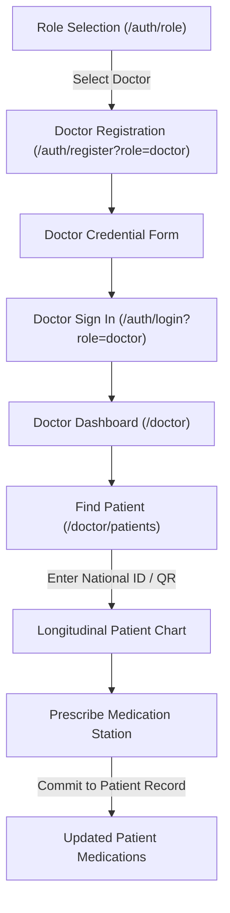
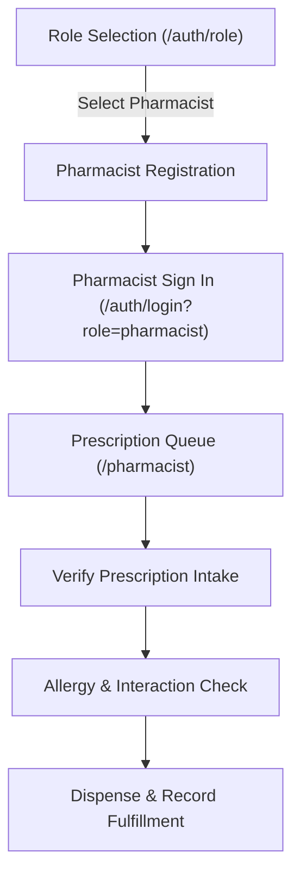

# PulseID — Connected User Journeys & Workflow Specifications

## 1. Overview

This document specifies the end-to-end user journeys for PulseID's three supported user roles:
1. **Patient** (Healthcare Consumer)
2. **Doctor** (Clinical Healthcare Provider)
3. **Pharmacist** (Pharmaceutical Professional)

Every journey defines the exact progression from application entry to workflow completion, cataloging authentication gates, API transactions, state transitions, and error handling.

---

## 2. Journey 1: Patient Complete Lifecycle

```mermaid
flowchart TD
    Start["Public Landing Page (/)"] --> RoleSelect["Role Selection (/auth/role)"]
    RoleSelect -->|Select Patient| RegPhone["Phone Entry (/auth/register)"]
    RegPhone --> OtpVerify["SMS OTP Screen (/auth/verify)"]
    OtpVerify --> PersonalInfo["Personal Info Form (/auth/register/info)"]
    PersonalInfo -->|Submit Registration| Login["Sign In Screen (/auth/login)"]
    Login -->|Authenticate| PatientHome["Patient Landing Page (/patient)"]
    
    PatientHome -->|First-Time Check (Incomplete)| EditProfile["Profile Edit Screen (/patient/profile/edit?first_time=true)"]
    EditProfile -->|Save Clinical Details| ViewProfile["Digital Medical ID (/patient/profile)"]
    
    PatientHome -->|Explore Records| Records["Medical Records Timeline (/patient/records)"]
    PatientHome -->|View Allergies & Meds| MedInfo["Medical Information (/patient/medical-info)"]
    PatientHome -->|Manage Permissions| AccessRequests["Consent & Access Requests (/patient/access-requests)"]
```

### Detailed Step Matrix: Patient Journey

| Step | Screen & Route | Authentication | Required User Data | API Operations | State Transitions & Success Criteria | Failure Conditions |
|---|---|---|---|---|---|---|
| **1.1 Entry** | `/` (Public Landing) | None | None | None | User clicks "Create Account" -> navigates to `/auth/role` | None |
| **1.2 Role Selection** | `/auth/role` (Figma `238:665`) | None | Role selection | None | User selects "Patient" -> navigates to `/auth/register?role=patient` | User doesn't pick role |
| **1.3 Phone Registration** | `/auth/register` (Figma `116:903`) | None | Country code, Phone number | Pre-checks format | Validates 10-14 digit Egyptian phone -> stores in AuthContext -> navigates to `/auth/verify` | Invalid telephone syntax |
| **1.4 OTP Verification** | `/auth/verify` (Figma `116:1127`) | None | 6-digit OTP code | Verification simulation | Inputs 6-digit code -> on confirmation, routes to `/auth/register/info` | Code mismatch / expiration |
| **1.5 Personal Info** | `/auth/register/info` (Figma `116:1028`) | None | Full name, National ID, Email, Password, Gender, Gov/City | `POST /api/v1/Patient/Create` or `POST /api/v1/Users/Create` | Submits `UserAddUpdateDTO` -> receives 200 OK -> navigates to `/auth/login?registered=true` | Duplicate email/phone; National ID validation error |
| **1.6 Sign In** | `/auth/login` (Figma `116:956`) | None | Phone/Email, Password | `POST /api/v1/Patient/Login` | Authenticates identity -> sets Bearer token in localStorage/cookies -> sets `pulseid_auth_role = "patient"` -> redirects to `/patient` | HTTP 401: Invalid credentials |
| **1.7 First-Time Guard** | `/patient` (Figma `299:4931`) | Authenticated (Patient) | Token | Checks `pulseid_patient_profile_completed` | If profile incomplete and user clicks "View my profile", redirects to `/patient/profile/edit?first_time=true` | Missing auth -> redirects to `/auth/login` |
| **1.8 Profile Completion** | `/patient/profile/edit` (Figma `299:5299`) | Authenticated (Patient) | DOB, Blood type, Chronic conditions, Allergies, Medications | `POST /api/v1/Patient/Update`, `GET /api/v1/BloodType/GetAll` | Submits clinical updates -> sets `pulseid_patient_profile_completed = "true"` -> routes to `/patient/profile` | Network timeout / validation error |
| **1.9 Digital Medical ID** | `/patient/profile` (Figma `299:6581`) | Authenticated (Patient) | Token | `GET /api/v1/Patient/getById?id=...` | Renders verified patient identity banner, emergency contacts, blood type, and clinical details | Profile not found (404) |
| **1.10 Records & Tabs** | `/patient/records` (Figma `299:994`, `299:3285`) | Authenticated (Patient) | Token | `POST /api/v1/CurrentMedications/GetAll`, `POST /api/v1/PastMedicalHistory/GetAll` | Displays category filters (Prescriptions, Labs, Diagnoses, Imaging) with doctor verification tags | Failed fetch -> error state with retry |

---

## 3. Journey 2: Doctor Clinical Workflow



### Detailed Step Matrix: Doctor Journey

| Step | Screen & Route | Authentication | Required User Data | API Operations | State Transitions & Success Criteria | Failure Conditions |
|---|---|---|---|---|---|---|
| **2.1 Role Entry** | `/auth/role` | None | Selects Doctor role | None | Routes to `/auth/register?role=doctor` | None |
| **2.2 Doctor Registration** | `/auth/register/doctor` | None | Name, Syndicate ID, Medical License, State, City, Password | `POST /api/v1/Doctor/Create` (DTO: `UserAddUpdateDoctorDTO`) | Persists doctor profile with `typeId: 2` -> routes to `/auth/login?role=doctor` | License format invalid |
| **2.3 Doctor Login** | `/auth/login?role=doctor` | None | Professional Email/ID, Password | `POST /api/v1/Users/Login` | Validates credentials -> sets doctor Bearer token & role -> navigates to `/doctor` | Invalid login (401) |
| **2.4 Clinical Dashboard** | `/doctor` (Figma `353:9999`) | Authenticated (Doctor) | Token | `POST /api/v1/Patient/GetAll`, `POST /api/v1/Doctor/getById` | Displays 3 overview cards (Active Patients, Consented Access, Consultations) + quick find patient tool | Unauthenticated -> redirects to login |
| **2.5 Patient Lookup** | `/doctor/patients` | Authenticated (Doctor) | Patient National ID / Phone | `POST /api/v1/Patient/GetAll` (Filter: NationalId) | Queries patient database -> presents verified patient summary banner | Patient not found (404) |
| **2.6 Chart Review** | `/doctor/patients/[id]` | Authenticated (Doctor) | Patient UUID | `POST /api/v1/AllergyMenu/GetAll`, `POST /api/v1/ChronicDiseases/GetAll`, `POST /api/v1/CurrentMedications/GetAll` | Displays longitudinal health timeline, active alerts (penicillin allergy), and past medical history | Unauthorized access (403) |
| **2.7 Medication Prescription** | `/doctor/patients/[id]/prescribe` | Authenticated (Doctor) | Drug name, dosage, frequency, instructions | `POST /api/v1/CurrentMedications/Create` | Directly registers prescribed medication into patient's active records -> displays success confirmation toast | Malformed drug record |

---

## 4. Journey 3: Pharmacist Verification & Dispense Workflow



### Detailed Step Matrix: Pharmacist Journey

| Step | Screen & Route | Authentication | Required User Data | API Operations | State Transitions & Success Criteria | Failure Conditions |
|---|---|---|---|---|---|---|
| **3.1 Role Selection** | `/auth/role` | None | Selects Pharmacist | None | Routes to `/auth/register?role=pharmacist` | None |
| **3.2 Registration** | `/auth/register/pharmacy` | None | Pharmacy Name, Commercial License, Syndicate ID, Password | `POST /api/v1/Users/Create` (`typeId: 3`) | Creates authorized pharmacy account -> navigates to `/auth/login?role=pharmacist` | License validation error |
| **3.3 Login** | `/auth/login?role=pharmacist` | None | Pharmacy Email, Password | `POST /api/v1/Users/Login` | Sets session token with role `pharmacist` -> redirects to `/pharmacist` | Invalid credentials (401) |
| **3.4 Intake Queue** | `/pharmacist` (Figma `103:1515`) | Authenticated (Pharmacist) | Token | `POST /api/v1/CurrentMedications/GetAll` | Displays active prescriptions awaiting dispensing | Unauthenticated -> redirects to login |
| **3.5 Patient ID Lookup** | `/pharmacist/dispense` | Authenticated (Pharmacist) | Patient ID / National ID | `GET /api/v1/Patient/getById`, `POST /api/v1/AllergyMenu/GetAll` | Retrieves patient's active allergies and pending medications | Invalid patient ID |
| **3.6 Allergy Safety Check** | `/pharmacist/dispense` | Authenticated (Pharmacist) | Selected Drug | Cross-references `AllergyMenu` | Highlights dangerous drug-allergy contraindications in red | Critical allergy detected -> requires clinical override |
| **3.7 Dispense Execution** | `/pharmacist/dispense` | Authenticated (Pharmacist) | Medication ID, Batch Number | `POST /api/v1/CurrentMedications/Update` | Marks medication item as Dispensed/Filled with timestamp -> prints receipt | Server error during update |
